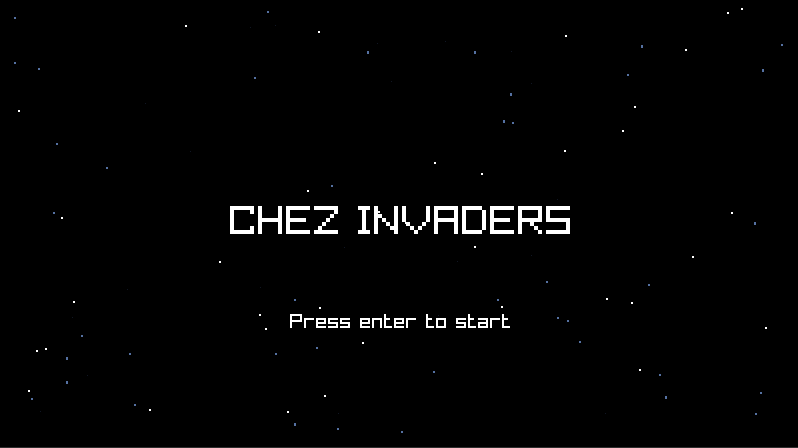
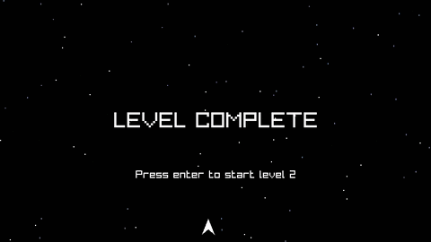

chez-invaders
=============

A small Space Invaders style Raylib game to show how to do game scripting in Chez Scheme. This project includes a REPL to execute Chez Scheme code directly in the game, hot reloading of changes, macros and libraries that are helpful for game development, and a CMake configuration to package the runtime into the executable for release.





Building
--------

In order to build you need to have all the dependencies for raylib and the `xxd`
command in the PATH (in order to convert the boot files into header files).

It also requires Chez Scheme to be installed at the CHEZ_INSTALL_DIR CMake
variable. You can modify that variable in `CMakeLists.txt` to the path of your Chez Scheme installation directory.

### To build in debug mode:

```
cmake -DCMAKE_BUILD_TYPE=Debug .
make
./chez-invaders
```

This builds and launches an executable with hot reloading and the REPL enabled.
You should be able to see the text with something like "Press p to reload ..."
at the top left of the window.

Then we can open `game.ss` with Emacs and start Geiser. Whenever we change the file and press `C-c C-k`, the game should
reload automatically or reload when 'p' is pressed, depending on whether auto reload is turned on or not.

### To build in release mode:

First go into utils.sls and uncomment the commented
version of `define-toplevel` and comment the existing version of `define-toplevel`.

Then run:
```
cmake -DCMAKE_BUILD_TYPE=Release .
make
./chez-invaders
```

Make sure that `game_boot.h` is deleted if it exists before recompiling and
whenever switching from Release to Debug or back that the *.so files for the
Scheme files are cleaned.

Building in Release mode bundles the Scheme and game boot files into the
executable so the only dependency is the dynamically linked Raylib library.
This allows you to distribute the program without requiring Chez Scheme to
be installed.